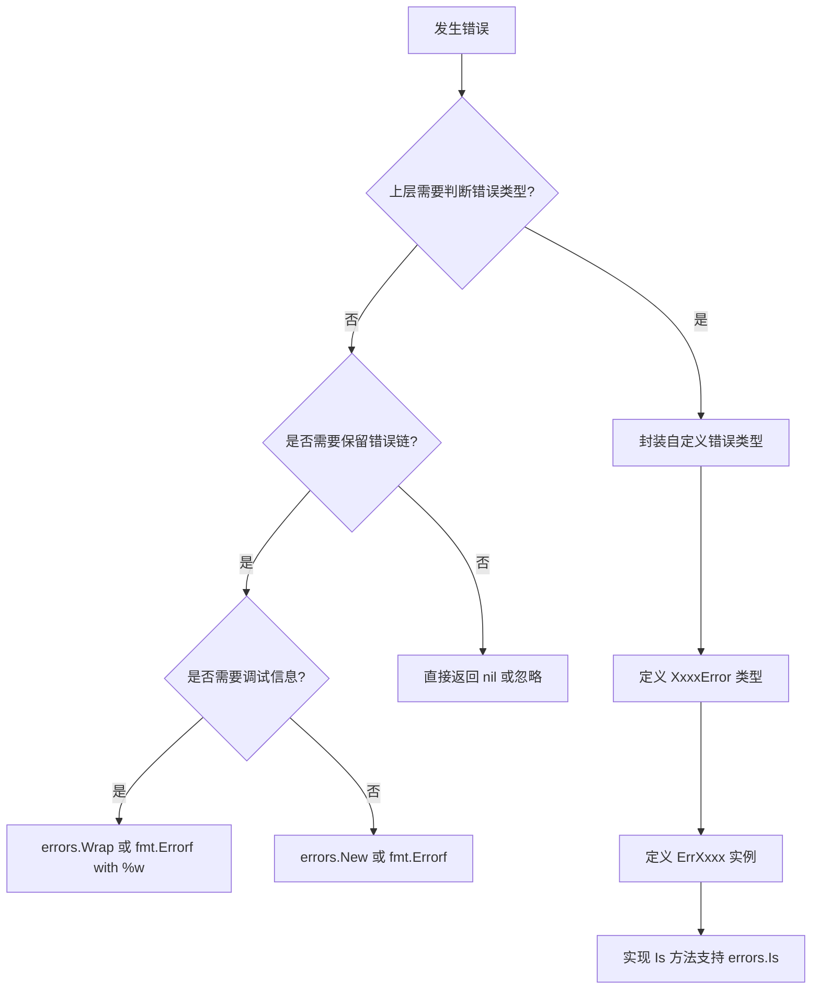

<!-- MarkdownTitleNumber auto -->

# 错误处理

## 1. 核心原则

**服务应该对上层屏蔽底层实现细节** - 这是错误处理的核心原则。

| 原则                       | 说明                                                                    |
| -------------------------- | ----------------------------------------------------------------------- |
| 封装错误类型               | service 层不应返回 db.ErrNotFound，应封装为 service.ErrNotFound         |
| 错误码用全大写加下划线     | `Code: "NOT_FOUND"`，看起来像不可变字符串常量                           |
| 不要在底层定义 HTTP status | db 层错误不应包含 status_code，由 handler 层根据 service 层错误类型判断 |
| 使用多分支处理             | 多分支错误处理用 `switch case` 或 `errors.Is` 链式判断                  |

## 2. 错误类型定义规范

```go
// 命名规范: 类型名 XxxxError，实例名 ErrXxxx
type NotFoundError struct {
    Code    string  // "NOT_FOUND" - 全大写加下划线
    Message string
    Cause   error   // 原始错误（可选）
}

var ErrNotFound = NotFoundError{
    Code:    "NOT_FOUND",
    Message: "resource not found",
}

func (e NotFoundError) Error() string {
    return e.Message
}

func (e NotFoundError) Is(target error) bool {
    // 支持 errors.Is 判断
    _, ok := target.(NotFoundError)
    return ok
}
```

## 3. 错误封装原则

```go
// ❌ 错误示例: service 层直接返回 db 错误
func (s *UserService) GetByID(ctx context.Context, id string) (*User, error) {
    user, err := s.db.FindByID(ctx, id)
    if err != nil {
        return nil, err  // 返回了 db.ErrNotFound，暴露底层细节
    }
    return user, nil
}

// ✅ 正确示例: service 层封装自己的错误类型
func (s *UserService) GetByID(ctx context.Context, id string) (*User, error) {
    user, err := s.db.FindByID(ctx, id)
    if err != nil {
        if errors.Is(err, db.ErrNotFound) {
            return nil, service.ErrNotFound  // 封装为 service 层错误
        }
        return nil, fmt.Errorf("failed to get user: %w", err)  // Wrap 其他错误
    }
    return user, nil
}
```

## 4. handler 层错误处理（HTTP API 场景）

```go
// handler 根据 service 层错误类型判断 HTTP status
func (h *Handler) GetUser(w http.ResponseWriter, r *http.Request) {
    user, err := h.service.GetByID(r.Context(), id)
    if err != nil {
        switch {
        case errors.Is(err, service.ErrNotFound):
            writeJSON(w, http.StatusNotFound, ErrorResponse{
                Code:    "NOT_FOUND",
                Message: "user not found",
            })
        case errors.Is(err, service.ErrUnauthorized):
            writeJSON(w, http.StatusUnauthorized, ErrorResponse{
                Code:    "UNAUTHORIZED",
                Message: "access denied",
            })
        default:
            writeJSON(w, http.StatusInternalServerError, ErrorResponse{
                Code:    "INTERNAL_ERROR",
                Message: "internal server error",
            })
        }
        return
    }
    writeJSON(w, http.StatusOK, user)
}
```

## 5. errors.AsType vs errors.As

```go
// Go 1.26+: 使用 errors.AsType（更简洁）
var ErrNotFound NotFoundError
if errors.AsType(err, &ErrNotFound) {
    // 处理 NotFoundError
}

// Go < 1.26: 使用 errors.As
if errors.As(err, &ErrNotFound) {
    // 处理 NotFoundError
}
```

## 6. 错误处理决策


