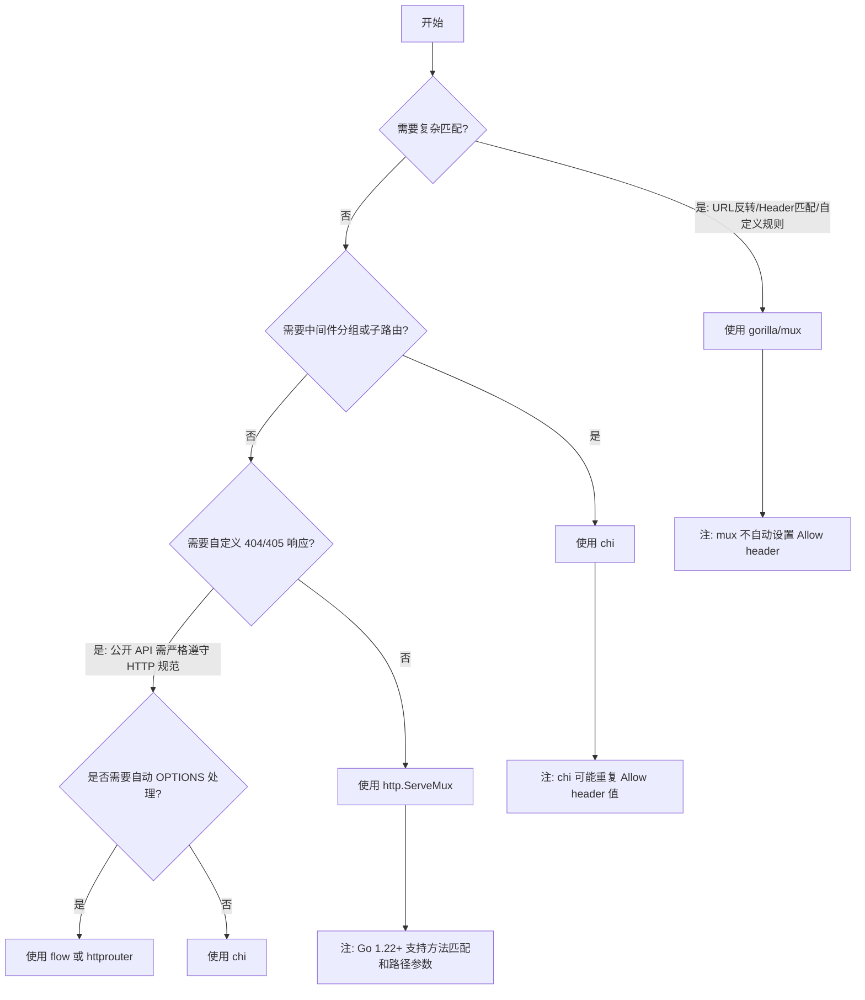

<!-- MarkdownTitleNumber auto -->

# 路由选择

构建 HTTP API 时，**只选择 100% 兼容 `net/http` 的路由包**，避免 gin、fasthttp、fiber 等不兼容包。

参考: [Which Go Router Should I Use?](https://www.alexedwards.net/blog/which-go-router-should-i-use) by Alex Edwards

## 1. 推荐路由（优先级排序）

| 路由                         | 特点                                | 适用场景               |
| ---------------------------- | ----------------------------------- | ---------------------- |
| **http.ServeMux** (Go 1.22+) | 标准库、零依赖、长期维护保障        | **大多数项目首选**     |
| **go-chi/chi**               | 轻量(~1000 LOC)、中间件分组、子路由 | 需要中间件分组、子路由 |
| **gorilla/mux**              | 功能丰富、URL 反转、Header 匹配     | 复杂匹配需求           |

## 2. 选择决策



## 3. 快速参考

### 3.1 http.ServeMux 快速参考 (Go 1.22+)

```go
import "net/http"

mux := http.NewServeMux()

// 方法匹配 + 路径参数
mux.HandleFunc("GET /users/{id}", getUser)
mux.HandleFunc("POST /users", createUser)

// 主机名匹配
mux.HandleFunc("example.com/api/", apiHandler)

// 获取路径参数
func getUser(w http.ResponseWriter, r *http.Request) {
    id := r.PathValue("id")  // Go 1.22+
}
```

### 3.2 chi 快速参考

```go
import "github.com/go-chi/chi/v5"
import "github.com/go-chi/chi/v5/middleware"

r := chi.NewRouter()
r.Use(middleware.Logger, middleware.Recoverer)

// 基础路由
r.Get("/users", listUsers)
r.Post("/users", createUser)

// URL 参数
r.Get("/users/{id}", getUser)
id := chi.URLParam(r, "id")

// 路由组（中间件分组）
r.Route("/articles", func(r chi.Router) {
    r.Get("/", listArticles)
    r.Route("/{id}", func(r chi.Router) {
        r.Use(articleCtx)  // 组级中间件
        r.Get("/", getArticle)
    })
})

// 子路由挂载
r.Mount("/admin", adminRouter())
```

### 3.3 mux 快速参考

```go
import "github.com/gorilla/mux"

r := mux.NewRouter()
r.Use(loggingMiddleware)

// 基础路由
r.HandleFunc("/users", listUsers).Methods("GET")

// URL 参数 + 正则
r.HandleFunc("/articles/{category}/{id:[0-9]+}", articleHandler)
vars := mux.Vars(r)
id := vars["id"]

// 命名路由（URL 反转）- mux 独有功能
r.HandleFunc("/articles/{id}", getArticle).Name("article")
url, _ := r.Get("article").URL("id", "42") // => /articles/42

// Header 匹配 - mux 独有功能
r.HandleFunc("/api", apiHandler).Headers("Content-Type", "application/json")

// 子路由
s := r.PathPrefix("/api").Subrouter()
s.HandleFunc("/users", UsersHandler)
```
